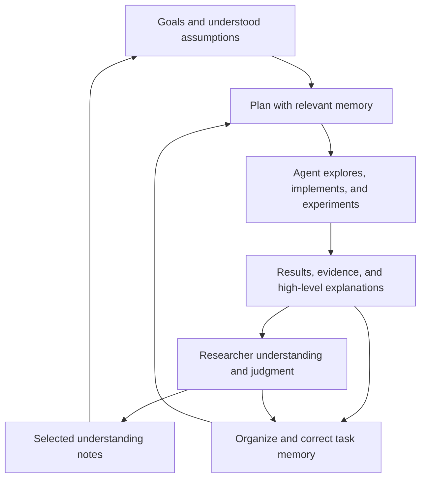

<TOCInline fromHeading={1} toHeading={2} toc={props.toc} />

---

Once an agent can search the literature, write code, analyze experimental results, and assemble those pieces into a paper, can we still tell whether its next revision is worth making?

This question has become increasingly important in our recent work on [AI for Paper][ai4paper]. We started by building literature tools and specialized skills, hoping to use AI agents to accelerate or take over parts of the research process. We then connected those capabilities and tried letting multiple agents advance a research project in parallel.

The workflow moved forward, but our understanding did not keep pace. Agents could propose methods we had not yet learned and continue revising the code and arguments they had generated. At that point, the difficulties began to center on three questions: how to judge the value of an exploration, how to preserve what we had understood, and how to make experience from one attempt influence the next.

This post follows that progression, from building tools to confronting those questions, and describes what we are working to improve.

## Giving Agents Access to the Materials Researchers Use

Research begins with reliable sources. If an agent relies only on knowledge already in the model, or on summaries and snippets returned by general web search, its picture of a specialized field may be incomplete. Recent work may be missing from its context, search results may lack full text, and citations may not correspond to accurate bibliographic records.

We built [apaper-mcp][apaper-mcp] to address this. It uses MCP, the Model Context Protocol, to expose search and download capabilities across academic sources. Although it began as arXiv Paper MCP, the current implementation covers arXiv, IACR ePrint, DBLP, Google Scholar, and CNKI.

The capabilities differ by source. An agent can search records of preprints and published papers, retrieve BibTeX entries through DBLP, and download paper PDFs using tools for sources such as arXiv and IACR ePrint. CNKI functionality depends on the appropriate institutional access. Search, citation retrieval, and access to original papers can then become part of the same workflow, reducing the need for us to move materials manually.

General web search remains useful, but it usually cannot replace source-specific integrations. Web indexes may cover only part of a source, while sites differ in page structure, access restrictions, and anti-bot measures. MCP provides a common interface for tool calls; the source implementations handle those differences. Actual availability still depends on the source, network, and access conditions.

The gap we want to close is straightforward: **public materials, or materials researchers are authorized to access, should also be available as context an agent can read and search.**

This continues the idea we discussed in [letting agents take over more local work loops][agent-observation]: give agents the ability to observe what humans could previously observe. In software development, that might mean a running page and its error logs. In research, it means original papers, citation records, and experimental materials. Access to those sources gives the agent a basis for working from actual evidence.

## Access to Information Still Needs Domain Methods

Once information is accessible, the next question is how the agent uses it.

In our experience, models tackling common engineering problems often start with general-purpose formulations and established optimization approaches. Training on code and standardized tasks makes these capabilities readily available. For work with clear goals and mature methods, this is often effective: implementing a known approach, completing experiment scripts, and organizing results can all benefit from existing patterns.

Exploratory tasks place different demands on that default behavior. Familiar methods can provide a starting point, but research also requires judging why existing approaches are limited, which assumptions are worth changing, and what a proposal adds to prior work. An agent that keeps optimizing along familiar lines may quickly deliver a complete plan without reaching the question we actually want to investigate.

We see a similar pattern in writing. Without domain-specific constraints, models tend to reuse fixed paragraph structures and generic phrasing—the recognizable "AI voice." In a paper, this goes beyond style. A fluent, confident statement of contributions can obscure the conditions under which a method applies or extend a conclusion beyond what the experiments support.

We use the [skills in apaper-plugin][apaper-skills] to address some of these specific problems. The writing skill emphasizes preserving technical meaning and using neutral, evidence-based language, with additional rules for journal writing, theorem statements, and LaTeX. The figure-creation skill organizes layout, typography, and rendered-output checks into a reusable workflow.

These rules bring professional expectations into the task context from the start, reducing the need to begin each session with a vague request to "make it more professional." Tools provide executable capabilities; skills provide methods for carrying out the work. Together, they help with parts of the research process. The value of a research direction and the novelty of a proposed method still require further judgment.

## Connecting the Pieces into a Highly Autonomous Research Attempt

With these tools and skills in place, we tried a highly autonomous paper workflow with multiple agents working in parallel. We will refer to the private project as **[Research Project A]**.

The process began with a literature search. We asked an agent to use the search tools to investigate recent developments in a narrow field, then moved into a planning stage. The agent proposed a technical approach, which we reviewed and adjusted. Tasks that could proceed in parallel were then assigned to multiple agents, continuing through code implementation, experimental analysis, and paper writing.

This covered several stages from gathering sources to producing a manuscript draft. We could delegate more execution work and review plans and outputs between stages. But as the task moved into exploration and innovation, a more important problem emerged: **some of the agent-generated content went beyond what we understood at the time.**

We could read a proposal and grasp its broad intent without being able to judge whether its central assumptions were reasonable, whether its claimed differences from existing methods held up, or why a particular change should improve the results. The rough understanding formed during plan review also failed to cover the details accumulating in the implementation and argument.

For familiar tasks, generate / verify is a natural division of work: the agent generates, and we verify using our knowledge, tests, and evidence. In this kind of exploratory task, we could still check whether the code ran and recheck some experimental results. But judging the method's value and novelty had moved beyond our existing ability to verify it.

The framework remained in place, but its verification stage no longer had a sufficiently reliable basis.

## When Iteration Starts to Feel Like a Lottery

In this situation, the conversation can always continue. We can ask an agent to improve the method, add experiments, reinterpret the results, or have another agent review the work. The system can keep returning new material, but we struggle to tell whether an iteration made progress or merely changed the presentation.

It increasingly feels like **drawing prizes without knowing what any of them are worth.**

Occasionally finding a better approach is valuable. The difficulty is recognizing why it is better so that we can decide whether to invest further. Without a sound basis for judgment, repeated conversations and revisions may circle around the same assumptions, as though stuck near a local optimum. Time and costs keep accumulating while the results fall short of expectations.

Our inability to understand something is not itself evidence of novelty. It might reflect a promising idea we need to learn, unnecessary complexity, omitted conditions, or faulty reasoning. Understanding and verification are still needed to tell these possibilities apart.

This is the question we raised in [If We Own the AI, Do We Own Its Ability?][ai-ability]. With an agent, a person can quickly produce code they could not otherwise write and advance research in an unfamiliar area. Receiving those outputs does not automatically give them the ability to explain, judge, or modify the work independently.

There is also a growing sense of losing control. The files belong to us, and the project lives in our repository, but the most direct way to change it is to ask an agent again. Over time, many decisions and their rationale exist only in agent-generated context. The phrase "AI has written context that only AI can understand" describes this maintenance relationship more accurately than a literal limit on human comprehension: we struggle to take over independently and keep relying on an agent to reconstruct and revise the work.

Pure mathematics makes the distinction particularly clear. Suppose an agent produces a long proof. Even if it passes formal checks, we still need to understand what the proposition means, which assumptions it uses, and why that proof strategy matters. Mechanical verification can answer some questions about correctness, but it does not automatically give the reader mathematical understanding.

Alongside faster generation, we therefore need a way of understanding the work that can keep pace with it.

## Keeping a Separate Record of What We Understand

Understanding every line of generated code is increasingly difficult as a default approach to long-running tasks. We are trying to shift our attention upward: first understand the research question, the method's core mechanism, its conditions, evidence, and limitations, then use those as a guide into the necessary details.

This higher-level understanding must retain enough information to support judgment. What assumptions does a method depend on? Were experimental comparisons made under matching conditions? Does a conclusion come from the original paper, an actual experiment, or our own inference? Without those distinctions, even a concise summary can become another generated artifact we cannot verify.

We have made one concrete practice part of our [paper-reading skill][paper-reading]: **keep reading records separate from the notes the reader chooses to preserve.**

`reading.md` records what the paper does, the questions the reader actually raised, relevant sources, and the scope of inspection. It helps the next session resume with the necessary context. `notes.md` saves a point, explanation, or question when the reader explicitly selects it, retaining necessary assumptions, source locations, and evidence status. Interpretations the reader has expressed are recorded as well.

This creates a clear distinction between "the agent has explained this" and "we chose to keep this." An unverified conjecture can still become a note, provided it remains labeled as a conjecture. An agent's explanation cannot automatically be treated as knowledge we have acquired simply because it appeared in the conversation.

These notes provide a persistent reference for later discussions. When we reopen a project, we can continue from the concepts and judgments we have retained, trace their sources, and see where questions remain. Understanding can accumulate across discussions instead of repeatedly getting buried beneath new code, long conversations, and manuscript drafts.

## Making the Next Attempt Use What the Last One Taught Us

Selected notes primarily help us keep up with the project. Agents also need to preserve reusable experience from their own attempts.

Complex research tasks often run for a long time and involve repeated revisions, comparisons, and retries. In our earlier plan-driven workflow, a plan could describe what to do next. But questions such as "Why did we abandon this approach last time?", "Which result is still uncertain?", and "Under what conditions did that change help?" often depended on our own memory. We then had to supply that context again in a new session.

This becomes difficult to sustain as attempts accumulate or multiple agents work in parallel. We are working toward persistent memory that can be retrieved according to the current task: retain a record of each attempt, then extract the experience that should influence future decisions.

Anthropic discusses a related approach in [The components of agent memory][agent-memory]. Memory can be maintained in layers, from raw session transcripts to memory notes, organized representations of knowledge, and context injected into a new session. The article also describes offline reflection, or dreaming, that checks original records, corrects mistaken notes, and reorganizes knowledge.

The most useful lesson for us is that memory's value depends on whether later tasks can use it. Full logs preserve a trail back to the evidence, distilled experience supports decisions, and the material entering each session needs to be selected around the current question. Loading the entire history into a new conversation increases reading costs and makes it easier for outdated judgments to keep influencing exploration.

For research, we want memory to answer a few connected questions: What hypothesis did this attempt address? What changed? What results were observed? Where is the evidence for the judgment? What can be reused when a similar problem arises? If a lesson applies only to a particular setup, those conditions need to be retained too. Both successful and failed attempts can be useful.

Memory itself also needs correction. One failure may not invalidate an entire approach, and one improvement may not support a general conclusion. If an agent turns an untested explanation into a rule, the next attempt may simply repeat the same mistake more efficiently. We want to retain experience that can be traced to evidence and revised when necessary.

Selected notes and task memory connect here: the former help us maintain our judgment about the research, while the latter help agents carry experience across attempts. Reading records and selected notes are already part of the skill. More complete mechanisms for recording attempts, organizing memory, and injecting relevant context remain work in progress. We hope to build toward the following loop:

Within this loop, repeated attempts have a chance to become continuous exploration. We know what question each iteration is trying to answer, and agents can use earlier experience to adjust what they do next.

## The Research Agent We Want to Build

Looking back, building AI for Paper has changed what we focus on in domain-specific applications. We initially asked whether agents could obtain the literature and perform specialized tasks. After connecting tools and skills, we began asking whether we could understand the exploration, judge its results, and accumulate experience across sessions.

That is what we now want from a research agent: the ability to make repeated attempts, improve through feedback, and gradually find valuable new directions while keeping the process understandable and observable to us. We can delegate more implementation details while retaining a grasp of the key assumptions, evidence, and research direction.

High-quality papers and more capable domain-specific agents remain our goals. We want each round of work to leave us with clearer understanding and experience the next round can actually use, alongside the code and drafts. As the exploration goes further, we should still be able to tell where we have arrived.

[ai4paper]: https://github.com/ai4paper
[apaper-mcp]: https://github.com/ai4paper/apaper-mcp
[apaper-skills]: https://github.com/ai4paper/apaper-plugin/tree/main/skills
[paper-reading]: https://github.com/isomoes/q1-grover-oracle/tree/main/.agents/skills/paper-reading
[agent-memory]: https://www.anthropic.com/research/components-of-agent-memory
[agent-observation]: /en/blog/tools/ai-agent-own-what-we-owned
[ai-ability]: /en/blog/tools/is-ai-ability-really-our-ability
