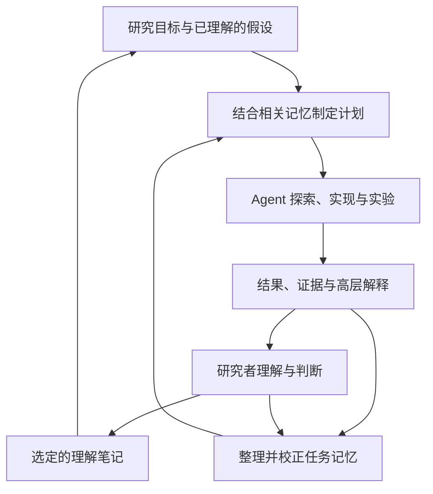

<TOCInline fromHeading={1} toHeading={2} toc={props.toc} />

---

当 Agent 已经能查文献、写代码、分析实验结果，甚至把这些内容组织成一篇论文之后，我们还能判断它的下一次修改究竟有没有价值吗？

这是我们最近围绕 [AI for Paper][ai4paper] 做尝试时，越来越在意的问题。最初，我们希望借助 AI Agent 加速或替代部分科研流程，于是从文献检索工具和专业 skills 开始搭建。随后，我们把这些能力串起来，尝试让多个 Agent 并行推进一个研究项目。

流程确实向前走了，但人的理解没有同步跟上。Agent 可以提出我们尚未掌握的方法，也可以继续修改自己生成的代码和论述。到了这个阶段，困难逐渐集中到三个问题上：我们如何判断探索的价值，如何保留自己已经理解的内容，以及如何让上一轮的经验真正影响下一轮尝试。

这篇文章记录的，就是我们从工具搭建走到这些问题的过程，以及目前正在改进的方向。

## 先让 Agent 接触研究者使用的资料

科研工作首先需要可靠的信息来源。如果 Agent 只能依赖模型内部已有的知识，或者通用 Web Search 返回的摘要与网页片段，它对一个小领域的认识就可能是不完整的：最新工作没有进入上下文，搜索结果缺少正文，引用也未必能够对应到准确的文献记录。

我们为此搭建了 [apaper-mcp][apaper-mcp]。它通过 MCP，也就是 Model Context Protocol，把不同学术来源的检索与下载能力暴露给 Agent。虽然起点是 arXiv Paper MCP，目前的实现已经覆盖 arXiv、IACR ePrint、DBLP、Google Scholar 和知网。

这些来源提供的能力并不完全相同。Agent 可以检索预印本和已发表论文的记录，通过 DBLP 获取 BibTeX 条目，并使用 arXiv、IACR ePrint 等来源的下载工具获取论文 PDF。知网相关功能则依赖相应的机构访问条件。这样，检索、引用和原文获取就能够进入同一个工作流，而不必每次都由我们手动搬运资料。

通用 Web Search 依然有用，但它通常不能替代对专业数据源的适配。网页索引可能只覆盖部分内容，不同站点也有不同的页面结构、访问限制和反爬机制。MCP 提供统一的调用接口，具体的数据源实现负责处理这些差异；实际可获取的范围仍取决于来源、网络和访问条件。

我们希望逐步缩小的是这样一种差距：**研究者能够获取的公开或已获授权的资料，也能够成为 Agent 可读取、可检索的上下文。**

这延续了我们在[让 Agent 接管更多局部工作循环][agent-observation]中讨论的思路：给 Agent 提供人原本拥有的观察能力。软件开发中，这可能是运行中的页面和错误日志；科研中，则是原始论文、引用记录和实验材料。有了这些信息，Agent 才有条件基于实际资料开展工作。

## 有了资料，还需要领域方法

信息可达之后，下一个问题是 Agent 会怎样使用这些信息。

在我们的使用中，模型处理常见工程问题时，往往会优先提出通用建模方式和成熟的优化路线。代码与标准化任务上的训练，使这类能力很容易被调用出来。对于目标明确、方法成熟的工作，这通常很有效：实现一个已知方案、补齐实验脚本、整理结果，都可以从现成经验中获益。

探索性任务对这种默认倾向提出了不同要求。常见方法可以成为起点，但研究还需要判断：已有路线为什么受限，哪些假设值得改变，以及一个方案相对于已有工作究竟增加了什么。如果只沿着最熟悉的路径继续优化，Agent 可能很快给出完整方案，却始终没有触及我们真正想研究的问题。

写作中也能看到类似现象。缺少领域约束时，模型容易反复使用固定的段落组织和泛化表述，也就是我们常说的“AI 味”。在论文里，这不只是语言风格的问题：一段流畅、肯定的贡献描述，可能掩盖方法的适用条件，或者让结论超出实验实际支持的范围。

我们通过 [apaper-plugin 的 skills][apaper-skills] 来缓解这些局部问题。其中，写作 skill 强调保留技术含义、使用中性且基于证据的表述，并针对期刊写作、定理陈述和 LaTeX 等场景提供更具体的规则；制图 skill 则把科研图示的布局、排版与渲染检查组织成可复用流程。

这些规则让专业要求能够在任务开始时进入上下文，减少每次都从一句“写得更专业一点”重新摸索的成本。Tools 提供可执行的能力，skills 提供完成任务的方法。两者结合，已经能够缓解科研流程中的一部分问题；至于研究方向是否有价值、方案是否具有创新性，还需要进一步判断。

## 把这些能力串成一次高自主论文尝试

在这些工具和 skills 的基础上，我们尝试了一次多 Agent 并行的高自主论文工作流。这里把对应的私有项目记为 **[研究项目 A]**。

流程从文献搜索开始。我们让 Agent 使用检索工具了解一个细分方向的近期进展，再进入 plan 阶段，由 Agent 提出技术路线，我们参与审阅和调整。之后，把能够并行推进的任务交给多个 Agent，继续完成代码实现、实验结果分析，以及最后的论文写作。

这个过程覆盖了从资料获取到论文草稿的多个环节。我们能够让 Agent 承担更多执行工作，也能够在阶段之间审查计划和产出。但当任务进入探索与创新部分时，一个更关键的问题出现了：**Agent 生成的部分内容，超出了我们当时的理解边界。**

我们可以读完一份方案，知道它大致想做什么，却未必能够判断它的关键假设是否合理、与已有方法的差别是否成立，或者某一次改动为什么应该改善结果。审阅 plan 时形成的粗略认识，也不足以覆盖后续实现和论证中不断增加的细节。

在熟悉的任务里，generate / verify 是一个自然的分工：Agent 生成，我们根据自己掌握的知识、测试和证据做验证。到了这类探索任务中，代码是否运行仍然可以检查，部分实验结果也可以复核，但对方法价值和创新性的判断，已经超出了原有的验证能力。

框架的形式还在，verify 却失去了足够可靠的依据。

## 当迭代开始像抽奖

这种状态下，每一轮对话都可以继续。我们可以要求 Agent 改进方法、增加实验、重新解释结果，或者让另一个 Agent 提出审查意见。系统总能交回一些新内容，但我们很难知道：这一轮究竟取得了进展，还是只换了一种表达？

我们的感受越来越像是：**不断抽奖，却不知道抽到的奖到底值多少钱。**

偶尔得到一个更好的方案当然有价值。问题在于，我们需要识别它为什么更好，才能决定是否继续投入。如果判断依据不足，反复对话和修改就可能一直围绕同一套假设打转，像是困在一个局部最优附近。时间和费用持续增加，结果却没有达到预期。

同时，“我们暂时看不懂”本身也不能作为创新性的证据。它可能来自一个值得学习的新思路，也可能来自不必要的复杂化、遗漏的条件，甚至错误的推理。需要补上的仍然是理解与验证。

这也是我们此前在[如果我们拥有 AI，我们也拥有它的能力吗？][ai-ability]中提出的问题。一个人借助 Agent，可以很快写出原本不会写的代码，推进原本不熟悉的研究。但获得这些产出，并不会自动带来独立解释、判断和修改它们的能力。

随之而来的还有一种失去掌控的感觉：文件属于我们，项目也在我们的仓库里，可一旦需要修改，最直接的办法还是重新找 Agent。久而久之，大量决策理由只存在于它生成的上下文中。所谓“AI 写出了只有 AI 能理解的 context”，更准确地描述的是这种维护关系：我们已经难以独立接手，只能继续依赖 Agent 去还原和修改。

把这个问题放到纯数学里会更直观。假设 Agent 给出了一份很长的证明，即使它能够通过形式化检查，我们也仍然需要理解命题的含义、使用的假设，以及为什么这条证明路径值得关注。机械验证可以回答一部分正确性问题，却不会自动把数学理解交给阅读者。

因此，继续提高生成速度之外，我们还需要一种能跟上生成结果的理解方式。

## 把我们理解的内容单独留下来

逐行理解所有生成代码，已经很难成为长程任务中的默认工作方式。我们正在尝试把理解的重点上移：先掌握研究问题、方法的核心机制、成立条件、证据和局限，再沿着这些线索进入必要的细节。

这种高层理解必须保留足够的判断依据。例如，一个方法依赖什么前提，实验比较是否处于相同条件，一项结论来自论文原文、实际实验还是我们的推测。否则，再短的总结也可能只是另一份我们无法验证的生成内容。

我们在 [paper-reading skill][paper-reading] 中，已经把一个具体做法写进流程：**将阅读记录与读者选定的理解笔记分别保存。**

`reading.md` 记录论文做了什么、读者实际提出的问题、相关来源和阅读范围，帮助下一次会话恢复现场。`notes.md` 则在读者明确选择某个观点、解释或问题时保存对应内容，并保留必要的假设、来源位置和证据状态。读者表达过的理解也会被记录下来。

这让“Agent 已经解释过”与“我们决定保留什么”有了明确区别。一个尚未证实的猜想也可以成为笔记，只要它仍被标明为猜想；一段 Agent 的解释，则不能因为出现在对话里，就自动被当成我们已经掌握的知识。

这些 notes 为后续讨论提供了一份持久的参照。重新打开项目时，我们可以从已保留的概念和判断继续推进，追溯它们的来源，并看到哪些地方还有疑问。随着讨论进行，理解能够逐步积累，而不必每次都淹没在新的代码、长对话和论文草稿里。

## 让下一轮用上上一轮的经验

理解笔记主要帮助我们跟上项目。对于 Agent，自身的尝试也需要留下可复用的经验。

复杂科研任务往往持续很长时间，需要多次修改、比较和重试。在此前以 plan 驱动的工作方式里，计划能够描述下一步做什么，但“为什么上次放弃这条路线”“哪个结果还不能相信”“什么条件下某个改动才有效”，经常仍靠我们自己记住，再在新会话里补充给 Agent。

当尝试次数增加，或者多个 Agent 并行工作时，这种方式就很难维持。我们正在改进的方向，是让尝试过程形成可持久保存、能够按任务检索的 memory：保留每次尝试的记录，再从中提炼会影响后续决策的经验。

Anthropic 在 [The components of agent memory][agent-memory] 中讨论了一套相关思路：从原始会话记录，到记忆笔记、组织后的知识表示，再到注入新会话的上下文，记忆可以分层维护。文章还介绍了通过离线回顾，也就是 dreaming，检查原始记录、纠正错误笔记和重新组织知识的做法。

这里对我们最有启发的一点是，记忆的价值取决于后续任务能否用上它。完整日志保留追溯线索，提炼后的经验帮助决策，而每次进入上下文的内容需要围绕当前问题选择。把所有历史记录都塞进新会话，既增加阅读成本，也容易让过时判断继续影响探索。

具体到科研任务，我们希望记忆能回答这样一组问题：这轮尝试针对什么假设，做了什么改变，观察到了什么结果，判断依据在哪里，以及下一次遇到相近问题时可以复用什么。如果某条经验只适用于特定设置，它的适用条件也需要一起保留。成功的尝试与失败的尝试都可能有用。

记忆本身同样需要校正。一次失败未必能否定整条路线，一次改善也未必能支撑普遍结论。如果 Agent 把未经检验的解释写成规则，下一轮就可能更熟练地重复同一个误判。我们希望保存的，是能够回到证据、允许修订的经验。

理解笔记和任务记忆由此连接起来：前者帮助我们保持对研究的判断，后者帮助 Agent 在多次尝试之间延续经验。目前，阅读记录与选定笔记已经落实到 skill 中，更完整的尝试记录、记忆整理和按需注入机制仍在改进。我们希望逐步形成下面这样的循环：

在这个循环里，多次尝试才有机会成为连续的探索：我们知道每一轮在回答什么问题，Agent 也能够利用之前的经验调整下一步。

## 我们希望得到怎样的科研 Agent

回头看，AI for Paper 的搭建过程让我们对垂类应用的关注点发生了变化。最初，我们关心文献能否获取、专业任务能否执行；把工具和 skills 接起来之后，我们开始关心，整个探索过程能否被理解，结果能否被判断，经验能否跨越会话持续积累。

这也是我们目前对科研 Agent 的期待：让它在我们能够理解和观察的状态下，多次尝试、根据反馈改进，并逐步找到有价值的创新路径。我们可以把更多实现细节交给 Agent，同时保留对关键假设、证据和研究方向的掌握。

高水平论文和更成熟的垂类 Agent 仍然是目标。接下来，我们希望每一轮工作除了留下代码和草稿，也能留下更清楚的理解，以及下一轮真正可以利用的经验。这样，探索走得更远时，我们也能知道自己走到了哪里。

[ai4paper]: https://github.com/ai4paper
[apaper-mcp]: https://github.com/ai4paper/apaper-mcp
[apaper-skills]: https://github.com/ai4paper/apaper-plugin/tree/main/skills
[paper-reading]: https://github.com/isomoes/q1-grover-oracle/tree/main/.agents/skills/paper-reading
[agent-memory]: https://www.anthropic.com/research/components-of-agent-memory
[agent-observation]: /zh/blog/tools/ai-agent-own-what-we-owned
[ai-ability]: /zh/blog/tools/is-ai-ability-really-our-ability
